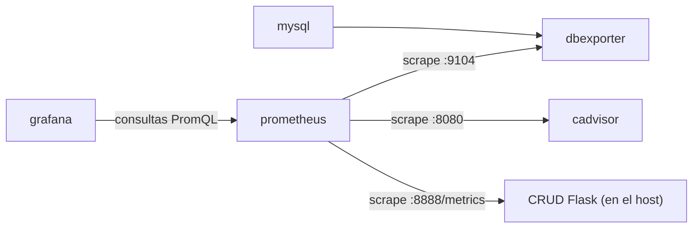
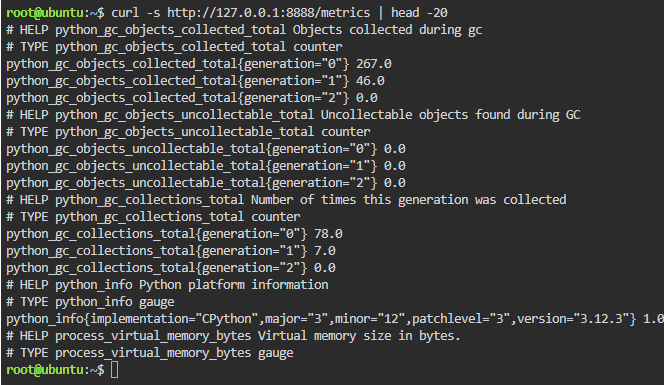
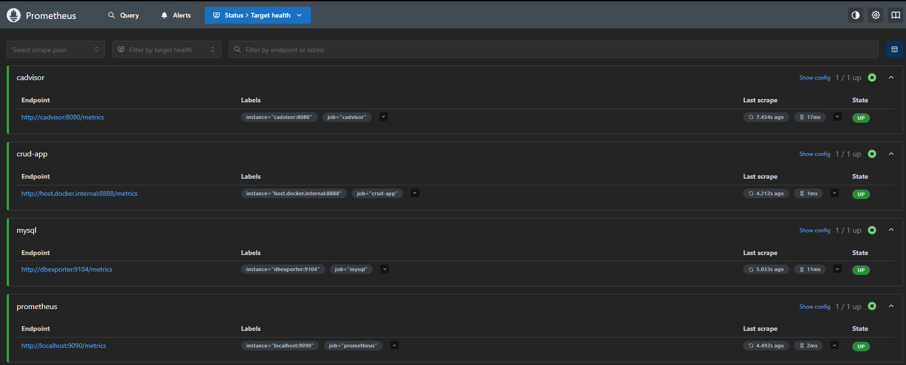
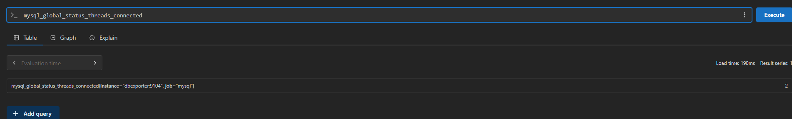
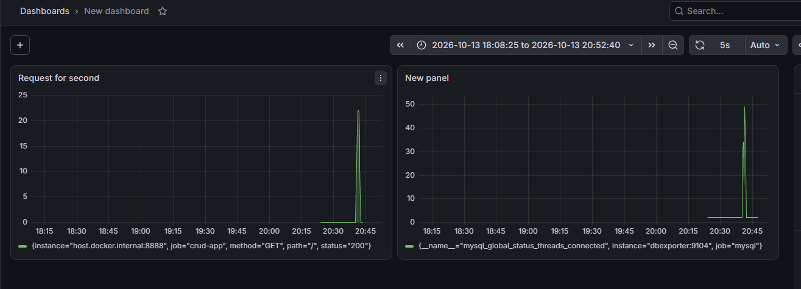

# Stack de monitoreo con Prometheus y Grafana — Explicación del `docker-compose.yml`

**Materia:** Infraestructura de Redes · Etapa final del hilo conductor
**Modalidad:** trabajo individual
**Autor:** Valentín Albornoz

---

## Introducción

Este informe explica el `docker-compose.yml` usado en la práctica de monitoreo en Killercoda. El archivo levanta cinco servicios en contenedores que comparten una red de Docker, con el objetivo de ver en tiempo real qué ocurre con una aplicación y su base de datos.

| Servicio | Qué hace |
| --- | --- |
| `mysql` | Base de datos que se quiere observar. |
| `dbexporter` | Lee el estado interno de MySQL y lo publica en el formato que entiende Prometheus. |
| `cadvisor` | Mide CPU, memoria, red y disco de cada contenedor. |
| `prometheus` | Va a buscar las métricas a cada servicio y las guarda como series de tiempo. |
| `grafana` | Consulta a Prometheus y dibuja los datos en paneles. |

La aplicación CRUD en Flask **no** corre en un contenedor: se ejecuta directo en el host (puerto 8888) y expone sus métricas en `/metrics`. Esto condiciona cómo Prometheus la encuentra (se explica en la Parte 2).

### Estructura general del archivo

```yaml
version: '3'
services:
  # mysql, dbexporter, cadvisor, prometheus, grafana
networks:
  mynetwork:
```

- **`version`**: formato del archivo. Va entre comillas para que YAML lo tome como texto. En las versiones actuales de Compose está obsoleto y solo genera una advertencia.
- **`services`**: un bloque por contenedor. Todos usan `restart: always`.
- **`networks`**: declara las redes que se crean.

### Flujo de datos

Prometheus trabaja con el modelo *pull*: no es la aplicación la que envía datos, sino Prometheus el que los va a buscar cada pocos segundos (*scrape*).



### Organización del informe

1. Parte 1: `mysql` y `dbexporter`
2. Parte 2: `cadvisor` y `prometheus`
3. Parte 3: `grafana` y la red `mynetwork`
4. Práctica en Killercoda (evidencia con capturas)
5. Conclusión

---

## Parte 1 — Persistencia de datos: `mysql` y `dbexporter`

### El servicio `mysql`

```yaml
mysql:
  image: mysql:latest
  restart: always
  environment:
    MYSQL_ROOT_PASSWORD: mysecretpassword
  networks:
    - mynetwork
```

| Línea | Qué hace |
| --- | --- |
| `mysql:` | Nombre del servicio. También es su nombre de host dentro de la red. |
| `image: mysql:latest` | Imagen base del contenedor. `latest` apunta a la versión más reciente, así que el resultado puede cambiar con el tiempo. |
| `restart: always` | Docker reinicia el contenedor si se cae o si se reinicia Docker. |
| `environment:` | Variables de entorno que recibe el proceso del contenedor. |
| `MYSQL_ROOT_PASSWORD` | Variable que la imagen lee en el primer arranque para fijar la contraseña de `root`. |
| `networks: - mynetwork` | Conecta el contenedor a la red `mynetwork`. |

**¿Por qué la contraseña va por variable de entorno?** La imagen de MySQL es genérica y la usa cualquiera. Si la contraseña estuviera dentro de la imagen habría que construir una distinta por entorno. Con una variable, la imagen no cambia y el valor se entrega desde afuera al crear el contenedor.

**Límite:** la contraseña queda en texto plano en el compose y se puede ver inspeccionando el contenedor. Para un laboratorio sirve; en producción se usarían `secrets` de Docker o un `.env` que no se suba al repositorio.

**Persistencia:** el servicio no declara volumen para `/var/lib/mysql`, por lo que los datos viven dentro del contenedor y se pierden si este se elimina. Acá no importa porque solo se observa el comportamiento de la base.

### El servicio `dbexporter`

```yaml
dbexporter:
  image: prom/mysqld-exporter:latest
  restart: always
  volumes:
    - ./my.cnf:/.my.cnf:ro
  command:
    - --config.my-cnf=/.my.cnf
  depends_on:
    - mysql
  networks:
    - mynetwork
```

MySQL no habla el formato de Prometheus. `mysqld-exporter` lo resuelve: se conecta a MySQL, consulta sus contadores internos (conexiones, consultas, estado) y los publica por HTTP en el puerto 9104.

| Línea | Qué hace |
| --- | --- |
| `image: prom/mysqld-exporter:latest` | Imagen oficial del exporter para MySQL. |
| `volumes:` | Archivos o carpetas del host que se hacen visibles dentro del contenedor. |
| `./my.cnf:/.my.cnf:ro` | Formato `origen:destino:modo`. Deja el `my.cnf` del host en `/.my.cnf` dentro del contenedor, en solo lectura. |
| `command:` | Argumentos con los que arranca el programa. |
| `--config.my-cnf=/.my.cnf` | Indica dónde está el archivo con los datos de conexión a MySQL. |
| `depends_on: - mysql` | Docker inicia primero `mysql` y después este servicio. |

**¿Por qué `my.cnf` va de solo lectura?** Contiene credenciales de conexión, así que se monta como archivo en vez de escribirlas en la imagen o repetirlas en el compose. Con `:ro` el contenedor puede leerlo pero no modificarlo ni borrarlo, aunque el proceso tuviera un error o fuera comprometido. El exporter solo necesita leer: es el principio de mínimo privilegio.

**¿Qué relación hay entre `dbexporter` y `mysql`?** El exporter no tiene nada que medir si la base no existe, por eso `depends_on` fuerza el orden de arranque. Pero en esta forma simple solo controla el **orden**, no espera a que MySQL esté listo para aceptar conexiones; si el exporter arranca antes, puede fallar al conectarse, y `restart: always` lo ayuda a recuperarse.

### Sintaxis YAML de esta parte

- **Indentación:** la jerarquía se marca con espacios (dos por nivel). No se admiten tabuladores.
- **Pares `clave: valor`:** `image: mysql:latest`. Después de los dos puntos va un espacio.
- **Listas con guion:** `networks`, `volumes`, `command` y `depends_on` son listas.
- **Mapeo dentro de otro mapeo:** `environment:` contiene `MYSQL_ROOT_PASSWORD: ...`.
- **Cadenas con `:` internos:** `./my.cnf:/.my.cnf:ro` es un único texto con tres campos.

---

## Parte 2 — Recolección de métricas: `cadvisor` y `prometheus`

### El servicio `cadvisor`

```yaml
cadvisor:
  image: gcr.io/cadvisor/cadvisor:v0.47.2
  restart: always
  volumes:
    - /:/rootfs:ro
    - /var/run:/var/run:ro
    - /sys:/sys:ro
    - /var/lib/docker/:/var/lib/docker:ro
    - /dev/disk/:/dev/disk:ro
  networks:
    - mynetwork
```

cAdvisor observa a los demás contenedores y publica sus métricas en el puerto 8080. La imagen fija una versión (`v0.47.2`) y el prefijo `gcr.io/` indica que viene del registro de Google y no de Docker Hub.

**¿Por qué monta rutas del host?** Un contenedor solo ve su propio sistema de archivos, pero cAdvisor necesita ver a *otros* contenedores, y esa información la tiene el host:

| Ruta del host | Para qué la usa |
| --- | --- |
| `/` (como `/rootfs`) | Ver el sistema de archivos del host y calcular uso de disco. |
| `/var/run` | Contiene el socket de Docker, para saber qué contenedores existen. |
| `/sys` | El kernel expone ahí los *cgroups*, con los contadores de CPU y memoria. |
| `/var/lib/docker` | Datos y estado de los contenedores. |
| `/dev/disk` | Información de los discos. |

Todas llevan `:ro` porque cAdvisor solo **observa**: se le da mucha visibilidad sobre el host, pero sin permiso de escribir.

### El servicio `prometheus`

```yaml
prometheus:
  image: prom/prometheus:latest
  restart: always
  ports:
    - "9090:9090"
  volumes:
    - ./prometheus.yml:/etc/prometheus/prometheus.yml
  extra_hosts:
    - "host.docker.internal:host-gateway"
  networks:
    - mynetwork
```

**¿Qué puerto se publica y por qué?** `ports` usa el formato `"PUERTO_HOST:PUERTO_CONTENEDOR"`. Con `"9090:9090"`, lo que llega al 9090 del host pasa al 9090 del contenedor. Se publica porque hay que entrar a la interfaz web desde el navegador. cAdvisor, en cambio, no publica nada: su único cliente es Prometheus, que lo alcanza por la red interna como `cadvisor:8080`. Publicar solo lo imprescindible reduce lo expuesto.

**¿Qué resuelve `extra_hosts` con `host.docker.internal`?** La app Flask corre en el host, fuera de `mynetwork`, así que Prometheus no la puede encontrar por nombre de servicio. `extra_hosts` agrega una línea al `/etc/hosts` del contenedor para que `host.docker.internal` apunte al host; `host-gateway` es el valor especial con el que Docker completa esa dirección solo. En Linux ese nombre no existe por defecto (en Docker Desktop sí), por eso hay que declararlo. Gracias a esto funciona el target `host.docker.internal:8888`.

**¿Cómo recibe su configuración?** El volumen `./prometheus.yml:/etc/prometheus/prometheus.yml` deja el archivo del host en la ruta donde Prometheus busca su configuración. Así se cambia qué se monitorea editando un archivo, sin tocar la imagen. Este volumen no lleva `:ro`, aunque Prometheus solo lo lee.

### El archivo `prometheus.yml`

No forma parte del compose: es la configuración de Prometheus. Define cada cuánto consultar y a quién.

```yaml
global:
  scrape_interval: 5s

scrape_configs:
  - job_name: 'prometheus'
    static_configs:
      - targets: ['localhost:9090']

  - job_name: 'cadvisor'
    static_configs:
      - targets: ['cadvisor:8080']

  - job_name: 'mysql'
    static_configs:
      - targets: ['dbexporter:9104']

  - job_name: 'crud-app'
    static_configs:
      - targets: ['host.docker.internal:8888']
```

- **`scrape_interval: 5s`**: cada target se consulta cada 5 segundos.
- **`scrape_configs`**: lista de *jobs*; cada uno agrupa targets del mismo tipo.
- **`job_name`**: Prometheus lo agrega como etiqueta `job` a cada métrica.
- **`static_configs` / `targets`**: lista fija de direcciones `host:puerto`. Por defecto se pide la ruta `/metrics`, y la dirección queda como etiqueta `instance`.

Se usan tres formas de direccionar según dónde viva cada target: `localhost:9090` para Prometheus (dentro de su contenedor, `localhost` es él mismo), nombres de servicio para `cadvisor` y `dbexporter` (gracias a `mynetwork`), y `host.docker.internal` para la app que está fuera de la red.

### Sintaxis YAML de esta parte

- **Cadenas entre comillas:** `"9090:9090"` y `"host.docker.internal:host-gateway"` se escriben entre comillas para que YAML las lea siempre como texto. En puertos es una práctica recomendada: valores tipo `22:22` pueden interpretarse como un número en base 60.
- **Listas de cadenas** con patrón `origen:destino` en `volumes`, `ports` y `extra_hosts`.
- **Rutas absolutas y relativas:** `/sys` es absoluta del host; `./prometheus.yml` es relativa a la carpeta del compose.
- **Etiqueta de imagen:** `v0.47.2` fija una versión; `latest` puede cambiar.
- **Ruta completa de imagen:** `registro/organización/imagen:etiqueta`.
- **Lista de mapeos anidada** (en `prometheus.yml`): cada `- job_name:` abre un elemento de `scrape_configs`, y `targets` es una lista dentro de `static_configs`. `['cadvisor:8080']` es la forma en línea de escribir `- cadvisor:8080`.

---

## Parte 3 — Visualización y topología: `grafana` y la red `mynetwork`

### El servicio `grafana`

```yaml
grafana:
  # Versión fijada a propósito: la UI de Grafana cambia entre releases y la guía
  # (Paso 3) describe pantallas concretas. Con :latest la navegación descrita se
  # desincroniza sola. 13.2.2 es la versión contra la que está escrito el Paso 3.
  image: grafana/grafana:13.2.2
  restart: always
  ports:
    - "3000:3000"
  environment:
    - GF_SECURITY_ADMIN_PASSWORD=admin
  depends_on:
    - prometheus
  networks:
    - mynetwork
```

| Línea | Qué hace |
| --- | --- |
| `image: grafana/grafana:13.2.2` | Versión fija: la interfaz cambia entre versiones y la guía describe pantallas concretas. |
| `ports: - "3000:3000"` | Publica la web de Grafana en el puerto 3000 del host. |
| `environment: - GF_SECURITY_ADMIN_PASSWORD=admin` | Fija la contraseña inicial del usuario `admin`. |
| `depends_on: - prometheus` | Grafana arranca después de Prometheus. |
| `networks: - mynetwork` | Lo une a la red común. |

**¿Por qué Grafana depende de Prometheus?** Grafana no recolecta ni guarda métricas: solo las dibuja. Cada gráfico es el resultado de una consulta PromQL a Prometheus, que es su fuente de datos; sin él no hay qué mostrar. Como con `dbexporter`, `depends_on` ordena el arranque pero no garantiza que Prometheus ya esté respondiendo.

### La red `mynetwork`

```yaml
networks:
  mynetwork:
```

Compose crea esta red (tipo *bridge* por defecto) y conecta a ella los cinco servicios. En una red definida por el usuario, Docker incluye un **DNS interno**: cada contenedor se registra con el nombre de su servicio y los demás pueden usarlo en lugar de una IP.

| Quién consulta | A quién | Dirección |
| --- | --- | --- |
| Grafana | Prometheus | `http://prometheus:9090` |
| Prometheus | cAdvisor | `cadvisor:8080` |
| Prometheus | dbexporter | `dbexporter:9104` |
| Prometheus | App Flask (fuera de la red) | `host.docker.internal:8888` |

Las IP cambian cada vez que se recrea un contenedor, pero los nombres de servicio no. Además, la comunicación dentro de la red usa los puertos internos y **no necesita publicarlos**: por eso solo Prometheus y Grafana tienen `ports`, ya que son los únicos a los que se entra desde el navegador. Desde el navegador se usa `localhost:3000`, pero desde Grafana hacia Prometheus se usa `prometheus`: cada lado nombra según desde dónde mira.

### Sintaxis YAML de esta parte

- **Comentarios:** las líneas con `#` se ignoran. El bloque de Grafana tiene uno de tres líneas que explica por qué se fijó la versión.
- **`environment` como lista:** `- CLAVE=valor`. En `mysql` se vio la forma de mapeo (`CLAVE: valor`); Compose acepta las dos.
- **`networks` en dos lugares:** a nivel raíz *declara* las redes que existen; dentro de un servicio *indica a cuáles se une*.
- **Clave con valor vacío:** `mynetwork:` sin nada es válido y crea la red con la configuración por defecto.

---

## Práctica en Killercoda

Evidencia de lo realizado en la práctica, en el orden en que se hizo.

### Métricas vs. logs

Un **log** es un registro de eventos: una línea por petición o consulta, con todo el detalle. Sirve para investigar un momento puntual, pero hay que buscar el archivo, filtrarlo y leerlo (con `grep` y `awk` en la práctica anterior). Una **métrica** es un número que cambia en el tiempo (peticiones por segundo, conexiones, CPU): no cuenta la historia de cada petición, pero muestra tendencias y picos de un vistazo y permite alertar. Se complementan: métricas para detectar, logs para investigar.

### 1. Métricas de la aplicación

Con `curl -s http://127.0.0.1:8888/metrics | head -20` se ve el formato de texto que expone la app Flask. Cada métrica lleva una línea `# HELP` (descripción) y una `# TYPE` (`counter`, `gauge`, etc.). Prometheus lee exactamente este formato.



### 2. Targets en Prometheus

En *Status → Target health* aparecen los cuatro jobs definidos en `prometheus.yml` (`cadvisor`, `crud-app`, `mysql` y `prometheus`), los cuatro en estado **UP** y con último *scrape* de pocos segundos. Cada uno se consulta con la dirección que le corresponde: `cadvisor:8080`, `dbexporter:9104`, `localhost:9090` y `host.docker.internal:8888` para la app del host.



### 3. Métrica de MySQL

La consulta `mysql_global_status_threads_connected` devuelve cuántas conexiones tiene abiertas MySQL. En reposo el valor es **2**. La serie viene del job `mysql` con `instance="dbexporter:9104"`, lo que confirma que el dato pasa por el exporter y no directamente por MySQL. Es un *gauge*: un valor que sube y baja.



### 4. Dashboard en Grafana y prueba de carga

Se conectó Grafana a Prometheus con la URL `http://prometheus:9090` (el nombre del servicio, no `localhost`, porque corren en contenedores distintos de la misma red). Se armó un dashboard con dos paneles:

- **Requests por segundo:** `rate(flask_http_request_duration_seconds_count[1m])`. Cuenta los pedidos HTTP que recibe la app y, con `rate`, los convierte en un promedio por segundo sobre la última ventana de un minuto.
- **Conexiones a MySQL:** `mysql_global_status_threads_connected`.

El dashboard se dejó con refresco automático de 5 segundos. Después se generó tráfico contra la app:

```bash
seq 1 2000 | xargs -P 50 -I{} curl -s -o /dev/null http://127.0.0.1:8888/
```

El comando se lee de izquierda a derecha: `seq 1 2000` genera los números del 1 al 2000; `xargs -P 50 -I{}` ejecuta un comando por línea, hasta 50 en paralelo; y cada comando es un `curl` silencioso (`-s`) que descarta la respuesta (`-o /dev/null`) y pide la página principal. En total, 2000 peticiones con 50 simultáneas.

En la captura se ve el efecto sobre ambos paneles: las peticiones por segundo salen de 0 y llegan a un pico de alrededor de 22, y las conexiones a MySQL saltan de 2 a casi 50, coherente con las 50 peticiones simultáneas (cada request a `/` dispara una consulta a la base). Al terminar la carga, ambos valores vuelven al reposo.



**Sobre la forma de las curvas:** la subida y la bajada de requests son en rampa porque `rate(...[1m])` promedia el último minuto, así que en los primeros segundos el valor graficado queda por debajo del tráfico real. Las conexiones, en cambio, cambian más bruscamente porque un *gauge* muestra el valor del instante, no un promedio.

**Comparación con la práctica de logs.** Con logs había que esperar a que terminara la carga, buscar el archivo, filtrarlo con `grep` y `awk` y recién ahí notar el pico. Con Prometheus y Grafana el pico se vio mientras ocurría, sin abrir ningún archivo.

---

## Conclusión

Un stack de monitoreo es una cadena de piezas chicas que hacen cada una una sola tarea: el exporter traduce, cAdvisor mide contenedores, Prometheus recolecta y guarda, y Grafana muestra. El `docker-compose.yml` describe cómo se conectan y casi se lee como un diagrama.

Varias decisiones del archivo responden al criterio de dar solo lo necesario: los volúmenes de cAdvisor y de `my.cnf` son de solo lectura porque esos servicios solo observan o leen; solo Prometheus y Grafana publican puertos porque son los únicos a los que se entra desde afuera; y la comunicación interna usa nombres de servicio gracias al DNS de `mynetwork`, sin depender de IP que cambian. La app Flask, que corre en el host, muestra qué pasa cuando algo queda fuera de esa red y por qué hace falta `extra_hosts`.

También aparecieron límites del laboratorio que en un entorno real habría que resolver: contraseñas en texto plano en el compose, MySQL sin volumen para sus datos, imágenes con `latest`, el volumen de `prometheus.yml` sin `:ro`, y `depends_on` que ordena el arranque pero no espera a que el servicio esté realmente disponible (para eso existen los *healthchecks*).

Por último, la práctica dejó clara la diferencia entre métricas y logs: durante la prueba de carga el aumento de peticiones y de conexiones a MySQL, y su regreso al reposo, se vieron en el dashboard mientras ocurrían, algo que con logs solo se descubría una vez terminada la carga. En cuanto a YAML, el archivo mostró sus piezas básicas: jerarquía por indentación, pares clave-valor, listas con guion, comentarios con `#`, cadenas con comillas cuando contienen `:`, y formas equivalentes de escribir algunas estructuras (`environment` como mapeo o lista; listas en bloque o en línea).
